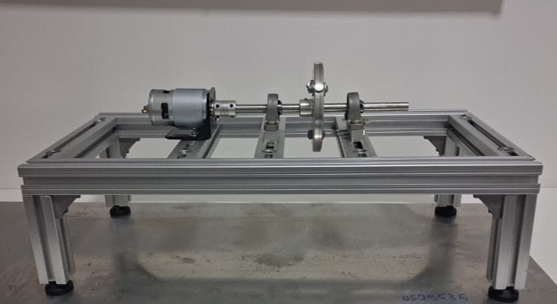

# Bancada didática de balanceamento de rotores

Programa Python para aquisição serial de sinais de aceleração, análise por FFT e balanceamento de rotores em um plano pelo **método das quatro voltas (quatro corridas)**, usando amplitudes, sem sensor de fase.

A bancada foi entregue ao orientador. Este repositório concentra os arquivos necessários para operar essa montagem e registrar os ensaios. Os algoritmos de aquisição, FFT e balanceamento foram preservados.

## Arquivos necessários

| Arquivo | Função |
| --- | --- |
| [quatro_corridas.py](quatro_corridas.py) | Aquisição serial, FFT, cálculo da massa e posição de correção e medição após a correção. |
| [requirements.txt](requirements.txt) | Dependências Python: NumPy, pyserial e Matplotlib. |
| [.gitignore](.gitignore) | Evita incluir no Git o ambiente Python, caches e resultados locais de ensaios. |
| [README.md](README.md) | Instalação, execução e procedimento experimental. |
| [Manual fotografado](docs/manual-controlador-velocidade-foto.jpg) | Foto original fornecida pelo autor; identificação explicada na seção de manuais. |
| [Foto da bancada](docs/bancada-cantoneiras-dos-pes.png) | Referência visual para localizar as cantoneiras de união dos pés à estrutura. |

As coletas, os gráficos e os relatórios são gerados em `dados_4corridas/`. Essa pasta não precisa existir antes da execução.

## Instalação no computador

É necessário ter Python 3 com `pip`, conexão USB com a placa de aquisição da bancada e um tacômetro para conferir a rotação. As instruções abaixo usam Windows/PowerShell.

1. Obtenha o repositório. O nome remoto termina com um ponto; o comando define uma pasta local sem esse ponto:

   ```powershell
   git clone https://github.com/PHSQ/tcc-balanceamento-rotores..git tcc-balanceamento-rotores
   cd tcc-balanceamento-rotores
   ```

   Também é possível baixar o ZIP pelo GitHub e abrir a pasta extraída. Para preservar o histórico local, use a opção com Git.

2. Confira o Python, crie um ambiente e instale as dependências:

   ```powershell
   python --version
   python -m venv .venv
   .\.venv\Scripts\python.exe -m pip install -r requirements.txt
   ```

   O ambiente é usado diretamente, sem precisar ativá-lo no PowerShell. Se `python` não estiver disponível, configure a instalação do Python antes de continuar. Referência: [ambientes virtuais do Python](https://docs.python.org/3/library/venv.html).

3. Conecte a placa de aquisição e confira a porta em **Gerenciador de Dispositivos > Portas (COM e LPT)**. Caso não apareça, confira o cabo USB, a conexão e o driver da placa utilizada.

4. Em `quatro_corridas.py`, ajuste apenas `PORTA_SERIAL` para a porta identificada. O padrão é `"COM3"`. A comunicação da montagem é **115200 baud**.

## Execução e parâmetros

Feche o Monitor Serial e outros programas que estejam usando a mesma porta. No terminal, dentro da pasta do repositório, execute:

```powershell
.\.venv\Scripts\python.exe quatro_corridas.py
```

O programa pergunta a **massa de teste em gramas** e a **rotação em RPM**, nessa ordem. ENTER aceita os valores padrão; a entrada aceita vírgula ou ponto decimal.

**Ao confirmar a rotação, a corrida 0 começa automaticamente.** Nesse momento, a bancada já deve estar estabilizada na rotação escolhida e sem a massa de teste temporária.

| Parâmetro atual | Valor e uso |
| --- | --- |
| Massa de teste padrão | 7,6 g; pode ser informada outra massa no início do ensaio. |
| Rotação padrão | 660 RPM; informe a rotação real conferida no tacômetro. |
| Raio de teste | 30 mm, anel D60, com posições 0°, 120° e 240°. |
| Raio de correção | 40 mm, anel D80, com 16 posições a cada 22,5°. |
| Massa inicial do rotor | `MASSA_TOTAL_ROTOR_G = 328.3`, estimativa do disco e eixo, sem a massa de teste temporária. É fixa no programa e não é solicitada na execução. |
| Aquisição por corrida | 3 coletas de 1.024 amostras; mediana das amplitudes 1× como resultado da corrida. |
| Busca do pico 1× | Em torno de `RPM / 60`, com margem de ±0,3 Hz. A taxa de amostragem é calculada a partir dos tempos recebidos. |

O Python recebe os sinais e faz os cálculos; **não controla a velocidade do motor nem mede RPM por um sensor de rotação**. O valor digitado orienta a busca do pico na FFT. Procure manter a rotação próxima desse valor e confira-a no tacômetro entre as leituras. Pequenas variações ocorreram nos ensaios do autor, e o método ainda apresentou bons resultados; não foi quantificada uma tolerância máxima de variação.

## Recomendações práticas para bons resultados

Antes de iniciar um ensaio, recomenda-se:

1. **Ajustar o aperto dos parafusos das cantoneiras dos pés.** São os parafusos das cantoneiras que unem os pés verticais à estrutura horizontal de perfis de alumínio, nos quatro cantos da bancada. O aperto dessas uniões influencia a resposta vibratória.
2. **Verificar a velocidade de rotação no tacômetro.** Aguarde a estabilização antes de cada coleta e procure manter a rotação próxima do valor escolhido nas quatro corridas e na verificação após a correção. Pequenas variações entre as leituras foram observadas nos ensaios, que ainda assim apresentaram bons resultados.
3. **Conferir as massas de desbalanceamento e de teste.** Use massas conhecidas, confira sua fixação e informe ao programa o valor efetivamente utilizado como massa de teste. Mantenha a massa de desbalanceamento fixa e desloque a mesma massa de teste entre 0°, 120° e 240°.



*As cantoneiras citadas ficam logo abaixo do quadro horizontal, no encontro com os quatro pés verticais. O motor aparece à esquerda na foto. As indicações de aperto abaixo se referem aos parafusos dessas cantoneiras de união.*

### Condições em que foram obtidos bons resultados

Nos ensaios realizados pelo autor nesta bancada, foram observados bons resultados nas seguintes condições:

| Condição | Resultado prático relatado |
| --- | --- |
| Aperto das cantoneiras — configuração 1 | Parafusos próximos ao motor **levemente apertados** e parafusos próximos ao acelerômetro **totalmente folgados**. |
| Aperto das cantoneiras — configuração 2 | **Todos os parafusos dessas cantoneiras bem folgados**, como alternativa à configuração 1. |
| Rotação | Bons resultados entre **640 e 950 RPM**, mesmo com pequenas variações entre as leituras. Escolha uma rotação nessa faixa e procure mantê-la aproximadamente estável ao longo do ensaio. A faixa relata as velocidades de ensaio e não define uma tolerância de variação entre leituras. |
| Massa de desbalanceamento | **10 g**, mantida na mesma posição durante o ensaio. |
| Massa de teste | **7,6 g**, deslocada entre as três posições do D60. |

Essas condições são observações experimentais desta montagem, sem garantia de reprodução em outras condições. “Levemente apertados” e “folgados” são descrições qualitativas; não foi informado torque de aperto. Faça os ajustes com o acionamento desligado e o rotor parado, preservando o apoio e a estabilidade estrutural da bancada. Folgar não significa retirar os parafusos ou desencaixar as cantoneiras.

É possível avaliar outras condições de aperto, massas e velocidades em ensaios separados, respeitando a recomendação de operação até aproximadamente 1.000 RPM. Ao alterar o aperto ou as massas, ou escolher outra rotação de ensaio, inicie um novo conjunto desde a corrida 0. Pequenas oscilações em torno da rotação escolhida não significam, por si só, a necessidade de reiniciar as quatro corridas.

**Nota sobre os valores no código:** a referência de **8 g** em `MASSA_DESBALANCEAMENTO_G` pertence à configuração descrita originalmente no programa e não é utilizada no cálculo da massa de correção. O ensaio relatado acima usou **10 g**; o código foi preservado. A massa inicial estimada de **328,3 g** é um parâmetro separado, usado na estimativa de qualidade após a correção, e não é atualizada automaticamente quando se muda a montagem.

## Procedimento experimental

“Quatro voltas” significa quatro condições de ensaio, cada uma com três coletas; não significa apenas quatro revoluções do eixo.

### 1. Preparar a montagem

- Com o rotor parado e o acionamento desligado, confira a fixação do sensor, dos pés, das cantoneiras e das massas.
- Defina a condição de aperto dos parafusos das cantoneiras dos pés antes de começar. **O aperto influencia a resposta vibratória da bancada.** Mantenha essa condição nas quatro corridas e na verificação final. Se alterar o aperto, inicie um novo conjunto de medições.
- Escolha um dos três furos do D60 como referência de **0°**. Use o próximo no sentido horário como **120°** e o seguinte como **240°**, sempre olhando o rotor pelo mesmo lado. Use a mesma referência angular para a correção no D80.
- Mantenha a massa de desbalanceamento fixa no D80; nos ensaios com bons resultados descritos acima, foram utilizados **10 g**. A massa de teste é temporária e se desloca entre os três furos do D60. Não remova nem mude a massa fixa de desbalanceamento durante a sequência.
- Confira a massa efetivamente usada como teste, incluindo os elementos de fixação que forem deslocados junto com ela. Informe esse valor ao programa.

### 2. Definir e estabilizar a rotação

Para esta bancada, recomenda-se operar **até aproximadamente 1.000 RPM**. Na montagem entregue, a região próxima desse valor foi associada a cerca de **29%–31% do ajuste do controlador**. Essa é uma referência prática da bancada, não uma conversão universal de porcentagem em RPM nem uma especificação do controlador OPW1. Confira sempre a rotação no tacômetro.

É possível experimentar outras massas de teste e velocidades **entre ensaios completos**, respeitando a faixa de operação recomendada. Dentro de um ensaio:

- Procure manter **a rotação aproximadamente estável e próxima do valor informado** nas quatro corridas e na medição após a correção, conferindo-a no tacômetro.
- Use **a mesma massa de teste e o mesmo raio** nas posições 0°, 120° e 240°.
- Mantenha a posição do sensor, a fixação da bancada e o aperto dos pés.

Se mudar a massa de teste, escolher outra rotação de ensaio ou alterar as condições de fixação, reinicie o procedimento desde a corrida 0. O programa solicita massa e RPM apenas no início; pequenas variações observadas durante as leituras não são corrigidas automaticamente por ele.

### 3. Executar as quatro corridas

**Pare completamente o rotor e desligue o acionamento antes de instalar, retirar ou deslocar qualquer massa.** Após cada intervenção, retome uma rotação próxima do valor escolhido, espere estabilizar e confira o tacômetro antes de autorizar a coleta.

| Corrida | Configuração | Ação no programa |
| --- | --- | --- |
| 0 — `A0` | Massa fixa de desbalanceamento, sem massa de teste. | Prepare essa condição antes de confirmar o RPM; a coleta começa automaticamente. |
| 1 — `A1` | Mesma configuração de base + massa de teste em 0° no D60. | Após reposicionar e estabilizar, pressione ENTER quando solicitado. |
| 2 — `A2` | Desloque a mesma massa de teste para 120° no D60. | Após reposicionar e estabilizar, pressione ENTER quando solicitado. |
| 3 — `A3` | Desloque a mesma massa de teste para 240° no D60. | Após reposicionar e estabilizar, pressione ENTER quando solicitado. |

Cada corrida faz três coletas consecutivas. Mantenha a montagem e evite ajustar o controlador durante essas coletas; pequenas oscilações naturais da rotação podem ocorrer, como observado nos ensaios.

### 4. Aplicar e verificar a correção

Ao terminar as quatro corridas, o programa apresenta a massa calculada, sua conversão para o raio do D80 e o ângulo de correção. Também indica o furo mais próximo no D80, numerado a partir de `#0`, em incrementos de 22,5°; alinhe essa numeração com a referência angular adotada.

1. Pare o rotor e desligue o acionamento.
2. **Retire a massa de teste do D60.** Preserve a configuração de base, incluindo a massa fixa de desbalanceamento.
3. Instale a massa de correção indicada no D80, no furo informado. O furo disponível aproxima o ângulo calculado; o relatório registra o erro angular desse arredondamento.
4. Retome uma rotação próxima do valor usado nas quatro corridas, espere estabilizar e confira o tacômetro.
5. No pedido de verificação, pressione ENTER para realizar mais três coletas (`run4_correcao`, resultado `A_final`), ou digite `n` para pular.

A verificação após a correção é uma medição adicional às quatro corridas. Ela permite comparar a amplitude inicial com a residual; um cálculo de correção, por si só, não demonstra que a vibração diminuiu.

## Resultados e interpretação

Os arquivos ficam em `dados_4corridas/`, relativa à pasta de onde o programa foi iniciado:

- `run0_baseline_coleta...csv`, `run1_0deg_coleta...csv`, `run2_120deg_coleta...csv` e `run3_240deg_coleta...csv`: tempo em milissegundos e aceleração em g.
- `run4_correcao_coleta...csv`: coletas adicionais, quando a verificação é realizada.
- Gráficos PNG: FFT das corridas e, quando o critério geométrico do programa é satisfeito, as circunferências do método.
- `resultado_...txt`: amplitudes, massa e posição de correção e, se medida, a resposta após a correção. É gravado quando o cálculo termina normalmente.

Os nomes incluem data e hora. Copie os resultados importantes para uma pasta de ensaio identificada, registrando massa de teste, RPM, referência angular e condição de aperto dos pés. A exclusão dessa pasta pelo `.gitignore` não substitui um backup dos dados experimentais.

Se o programa gerar **apenas FFT**, o critério de cruzamento das circunferências não foi satisfeito ou o cálculo encontrou dados inválidos. A versão atual ainda pode apresentar uma correção estimada quando não há cruzamento. Confira a estabilidade da rotação, a massa e as posições de teste e a fixação da bancada antes de interpretar esse resultado.

As estimativas de grau de balanceamento apresentadas pelo programa dependem da resposta vibratória e dos parâmetros da montagem, incluindo a massa inicial estimada de 328,3 g. Elas não constituem, isoladamente, comprovação de conformidade normativa.

## Dificuldades comuns

| Situação | O que conferir |
| --- | --- |
| Porta serial inexistente ou ocupada | Porta em `PORTA_SERIAL`, cabo USB e outros programas usando a placa. Feche o Monitor Serial. |
| Tempo de coleta excedido ou dados não encontrados | Conexão da placa, comunicação a 115200 baud e saída serial em duas colunas numéricas separadas por vírgula. |
| Resultados muito diferentes entre coletas | RPM no tacômetro, estabilização, posição do sensor, fixação das massas e aperto das cantoneiras. |
| Mensagem `T² <= 0` | As amplitudes não permitiram estimar a resposta da massa de teste. Confira a montagem e as medições; se mudar a massa ou escolher outra rotação de ensaio, repita o ensaio completo. |

## Manuais dos equipamentos

### Manual fotografado fornecido pelo autor

[Abrir a foto original do manual](docs/manual-controlador-velocidade-foto.jpg).

O título visível é **“User Manual for DC Digital Display Governor”**, referente a um controlador de velocidade com visor digital. A foto foi preservada sem edição ou transcrição das instruções.

### Identificação do controlador OPW1

A foto não apresenta identificação legível do modelo **OPW1**; a correspondência entre esse manual e o controlador da bancada ainda precisa ser confirmada. O manual específico do OPW1 será acrescentado ou identificado quando o autor fornecer o arquivo ou confirmar essa correspondência.

As observações de RPM e porcentagem neste README são referências práticas da bancada. Nenhum parâmetro, ligação ou instrução ausente do manual fornecido foi presumido.
